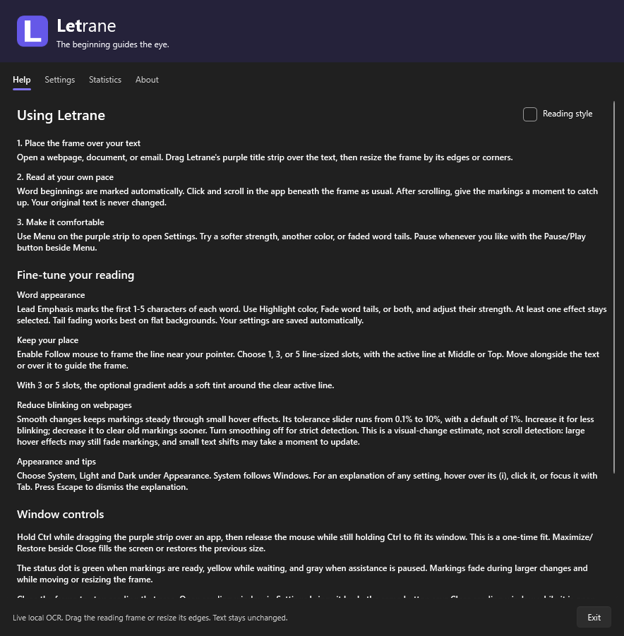
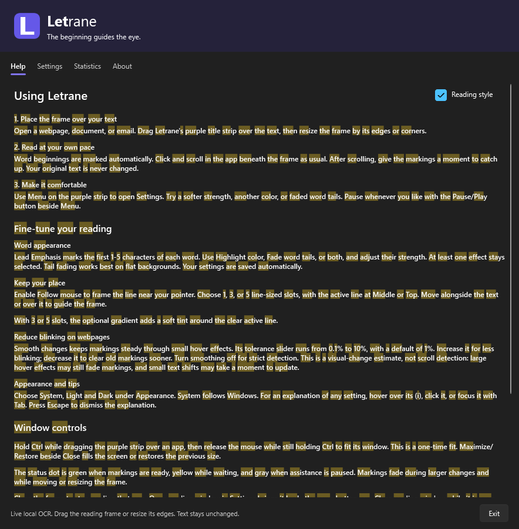
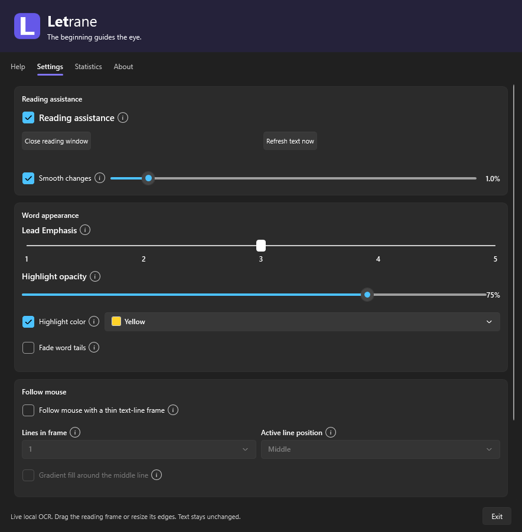

# Letrane releases

<picture>
  <source media="(prefers-color-scheme: dark)" srcset="assets/branding/letrane-wordmark-dark.svg">
  
</picture>

**The beginning guides the eye.**

Letrane is an experimental Windows reading-assistance app. Its transparent reading
window emphasizes word beginnings or gently fades word tails in other apps,
without changing the original text. Recognition runs locally using Windows OCR.
It is not a medical treatment and does not guarantee improved reading.

**[Download the latest signed Windows EXE](https://github.com/SimonSkotheimsvik/Letrane-Releases/releases/latest)**

## A calmer place for the eyes to land

Letrane began with a simple observation: my daughter, Ane, found text easier to
follow when the beginnings of words were emphasized. I wanted to explore a small,
practical tool that could bring those visual anchors to the text already on her
screen, rather than asking her to copy everything into a separate reading app.

The result is a movable reading frame for webpages, documents and emails. Place
it over the text, choose an appearance that feels comfortable, and keep using
the app underneath as usual. The original document stays unchanged.

Different people prefer different visual cues. Letrane lets you try highlighted
word beginnings, softer word tails, or both, and adjust their strength. It is an
experiment in making text more comfortable to follow, not a promise that one
reading style works for everyone.

## Why “Letrane”?

The name brings together **letters**, **Ane**, and a little bit of **rain**.
We live on Norway's rainy west coast, but the rain has another meaning too:
a busy page can feel like letters raining down, with nowhere for the eyes to
settle.

Letrane aims to add calmer places to land—small visual anchors at the beginnings
of words.

**Letters. Ane. Rain. Letrane.**

## What you can do

- **Read in other apps:** move and resize the transparent, always-on-top frame
  over the text you want to follow.
- **Make the emphasis comfortable:** choose colors, emphasize the first 1–5
  characters, and adjust highlight strength or word-tail fading.
- **Guide your place:** optionally follow the mouse with a thin reading-line
  frame and one, three or five line-sized slots.
- **Keep changes smooth:** tune how the markings respond to small webpage changes.
- **Match your desktop:** use System, Light or Dark appearance.
- **Start simply:** the Help tab opens first, with three quick steps and a
  built-in reading-style preview.
- **Keep recognition local:** Windows OCR processes the text on your device.
  Optional aggregate usage reporting and update checking are explained below.

## Screenshots

These are views of Letrane's actual interface, rendered with default settings
in a clean preview. No personal documents or desktop content are shown.

### Start with three simple steps

The Help tab explains how to position the frame, read at your own pace and make
the appearance comfortable.

### Try the reading style

The **Reading style** checkbox applies Letrane's emphasis directly to the Help
text. This shows the built-in preview—not a screenshot of OCR over another app.

### Make it your own

Reading assistance, word appearance and mouse-following controls are grouped
into compact cards, with explanations available from the small information icons.

## The visual identity

The purple icon contains a geometric **L** with a heavier leading stem and a
lighter trailing foot. The **Let**rane wordmark follows the same idea: an
emphasized beginning, followed by a quieter ending.

The brand purple is `#6558E8`, supported by deep `#25223A` and light `#F7F7FC`.
The branding echoes the app's visual-anchor idea; your reading-highlight color
is yours to choose.

## Download and run

Download `Letrane.App.exe` from the [latest release](https://github.com/SimonSkotheimsvik/Letrane-Releases/releases/latest)
and launch it directly.

- Windows 11 x64 with an installed Windows OCR language is required.
- No installer, administrator access or separate .NET runtime is required.
- The EXE is signed and timestamped. SmartScreen may still show a reputation warning.
- The optional `Letrane.App.exe.sha256` asset verifies the downloaded file.
- Local preferences and statistics are saved under `%LOCALAPPDATA%\Letrane`.

Open Help in the app for the quick-start guide. Drag the purple reading frame over
text, resize it, and use Menu to customize the appearance.

## Updates

The app checks this repository for a newer stable release at startup, at most
once per day. About has a manual **Check for updates** button and a saved option
to disable automatic checks. A newer version opens a release page in your
browser; the app does not download or install updates automatically. Update
checks send no usage totals or installation identifier; GitHub receives normal
request metadata and the app version.

Tags follow `vMAJOR.MINOR.PATCH`, matching the executable's app version.
Published assets are not replaced with different builds under the same version.
This repository hosts public downloads only; application source is maintained
separately. WinGet publication requires a separate package submission.

## Usage reporting

Usage sharing is on by default and can be disabled on Statistics. On normal
Exit, the app sends aggregate usage totals, first-use time, app version and a
hashed random installation identifier to the developer's Azure service in North
Europe. No screen content, recognized text, hardware identifiers or account names
are included. The identifier links reports from the same installation; reports
are pseudonymous, not fully anonymous.

Received reports are retained for 12 years (4,383 days). Opting out stops future
reports but does not erase existing reports early. Network services process
transport metadata. Reporting is separate from update checking.

## Freeware

Letrane is free to use. Optional support:
[Buy me a coffee](https://buymeacoffee.com/simonskothn).
